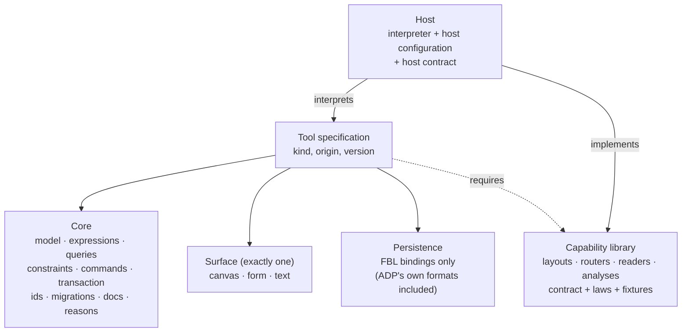

# One declarative language for a whole tool

A thought experiment: research, prior art, trade-offs and a proposed formulation.

Written 2026-10-13, against etalii.adp `develop` at `b30ff37`. This is research only; nothing in it is specified, planned or decided.

---

## Summary

1. **The idea.** One new language, declarative, in which a tool engineer describes a whole tool type: its model, its logic, its view and its persistence. For the view it admits only the primitives of DISL, DESL and EDSL; for persistence only those of FBL. Every host interprets it, so no tool needs host code.
2. **Most of it already exists, scattered.** DISL already has eight layers, from metamodel to behaviour, layout and persistence, plus a closed action language and CEL. DESL repeats DISL's foundations in its own words. FBL already serves both kinds. What is new in the idea is less the vocabulary than three rules: *one* document shape for every kind, *nothing* outside the vocabulary (no plugins, no `x-` keys, no companion `.md`), and *all* logic inside the language.
3. **The residue is the real question.** The 31 companion files under `definitions/` list the logic the languages cannot hold today. About two thirds of it is recurring and could become declarative primitives. About one third is irreducibly algorithmic: parsers for Turtle, SPARQL, Structurizr DSL and MSBuild, elementary-cycle enumeration, Sankey relaxation, a description-logic renderer. A declarative language can *name* these but cannot *contain* them without becoming a programming language.
4. **So "accept nothing else" needs a precise reading.** The formulation that survives is: *a tool specification accepts nothing but the language*, and the language owns a versioned **standard library of capabilities** (layouts, routers, readers, analyses), each specified by contract and test fixtures, added only through the specification process. Tool engineers never write code; the platform does, once per capability, not once per tool.
5. **Prior art supports the shape and warns about the edges.** Interpreted declarative tool definitions run industrial tools (declarative viewpoint specifications, metamodel-driven modelling tools, grammars of graphics). Every one of them grew an escape hatch, and that escape hatch is where portability failed. The systems that kept portability did so with a small closed catalogue, a host configuration, declared capabilities and a shared conformance suite.
6. **Recommendation, as an interpretation.** Do not add a fourth language beside DISL, DESL and EDSL. Refactor them into **one core** (model, expressions, queries, constraints, commands, transactions, ids, migrations, documentation) plus **one surface module per kind** (canvas, form/table, text), with **FBL as the only persistence** (DID and DED become ADP's own FBL bindings), a **capability library** for the residue and a **host contract**. A tool type is then one document that imports one surface and one or more bindings. This is the strongest declarative reading of the idea that remains complete.
7. **Relation to the TypeScript answer of 12 October.** The two are complementary, not rival. The language is what a tool engineer writes; portable code (TypeScript or WebAssembly) is how the platform implements a capability once for every host. The difference from that answer is who may write code: there, every tool could carry a plugin; here, only the capability library can.

---

## 1. The question, made precise

The proposal asks for a language with four properties at once:

| Property | Meaning |
|---|---|
| **Complete** | It describes *all* aspects of a tool type; nothing is left to a companion document or to host code. |
| **Closed** | The view side admits only DISL, DESL and EDSL primitives; the persistence side only FBL primitives; nothing else. |
| **Declarative** | It says *what* a tool is and does, not *how* to compute it step by step. (Added as an explicit aim.) |
| **Host-agnostic** | Standalone, IntelliJ, VS Code, Eclipse and Notion interpret the same document to the same result. |

The four pull against each other. Closedness and declarativeness together cap expressive power; completeness demands that every tool fit under that cap. Section 4 argues that all four can hold only if "closed" applies to the *tool specification* and the language itself keeps a governed way to grow.

## 2. Where ADP stands

### 2.1 The languages today

| Language | Kind | Size | State |
|---|---|---|---|
| DISL | diagram specification | 7,056 lines | 0.3/0.4 drafts; eight layers: metamodel, coordinates and snapping, notation, toolbox and forms, constraints, behaviour, layout, persistence; CEL environment; plugins (§13) |
| DID | diagram definition | 490 lines | stored diagrams, canonical writing |
| DESL | designer specification | 688 lines | 0.1; metamodel, persistence via FBL, constraints, one surface kind (`table`), operations with a closed action set, CEL |
| DED | designer definition | 143 lines | envelope `ded`/`designer` |
| EDSL, EDD | editor | 24 lines each | placeholders |
| FBL | persistence for every kind | 940 lines | five format families, splices, registration, readings, folder subjects, persistence-plugin contract, routing |

Three observations matter for the idea.

- **DISL is already a "whole tool" language for diagrams.** Its §1.1 lists exactly the aspects the proposal names, and its §1.2 states the goal: "a conforming runtime needs no language-specific code". Its behaviour layer (§9) is a closed, declarative action vocabulary (`set`, `create`, `connect`, `move`, `reparent`, `reorder`, `if`, `forEach`, `layout`, `notify`, …) run as one transaction (§14.4), with hooks, operations, confirmations, simulations (§9.6) and refusal reasons.
- **DESL duplicates DISL's foundations.** FBL §1.3 needs a two-column table mapping each concern to "DISL §x" and "DESL section y": metamodel, ids, findings, reading order, transaction, origin, localized text, CEL, extension properties. The same concepts are specified twice, in two documents that must be kept in step.
- **The escape hatch is designed in.** DISL §1.4 principle 1: "The common 90 % of diagram types must be expressible without code. The remaining 10 % is reached through named plugins." §13 lists thirteen extension points; FBL §11 defines a persistence-plugin contract and §11.5 names six formats "expected to stay plugins".

### 2.2 What falls outside today

Every tool type in `definitions/` has a companion `<tool>.md` for what its language cannot express. All 31 were read (30 diagrams, one designer; editors have none). Counted by tools affected:

| Gap category | Tools | Character |
|---|---|---|
| Persistence and format reading | ~27 | Only the hype cycle, agent activity diagram and knowledge designer are fully FBL-bound; the rest name custom formats or plugins |
| Host-specific concerns (viewport delivery, wire ids) | ~28 | Belong to hosts, not to the language |
| Layout | ~24 | Mostly variations of layered, tree, ring and band layouts |
| Validation beyond CEL | ~20 | Findings located at file and line, one finding per cycle, ordering of findings |
| Interaction | ~16 | Drop onto an element, drag to re-parent, clamp versus refuse, row drag |
| Id schemes | ~15 | Formula, derived, positional, sidecar, never stored |
| Custom UI | ~13 | State-dependent menu labels, picker-answered actions, read-only reasons, banners |
| Computation, derived data | ~13 | Cycle enumeration, view membership, traces, aggregation |
| Custom rendering | ~12 | Ribbons, badges, stage bands, superellipse |
| External data | ~12 | File watching, folder subjects, template resolution across files |
| Routing and geometry | ~11 | Bowed arcs, self-links, attach points at a fraction of a side, stubs |
| Element budgets | 5 | Truncation beyond a cap |

The gaps split cleanly into two populations.

**Recurring gaps, candidates for declarative primitives.** Positions kept in the registration rather than the model; read-only folder subjects re-read on change; findings at file and line; relations with a missing end drawn as stubs; layered layouts with a separate band (one parametrised algorithm would replace about seven plugins); state-dependent labels and read-only reasons; side-restricted anchors and fractional attach points; drop-onto-element tools; id schemes.

**One-off algorithmic gaps, candidates for code.** Johnson's elementary-cycle enumeration and loop auto-claiming (`causal-loop-diagram.md:69`); a self-organising arrange (`causal-loop-diagram.md:163`); Sankey relaxation, "24 passes, the n-th weighted 0.99^n" (`sankey.md:94`); SKOS cycle breaking (`w3c-skos.md:131`); the OWL description-logic renderer; the Turtle, SPARQL, Structurizr DSL and `.owm` parsers; MSBuild wildcard and import evaluation (`dotnet-dependency-graph.md:75`); C4 relationship elevation (`c4-context.md:63`); the knowledge designer's atomic two-file steps and parent-cycle check (`knowledge.md:223`, `:225`).

The trend is encouraging: the hype cycle's gaps were almost all absorbed into DISL 0.3 as standard keys (`gartner-hype-cycle-graph.md:220-233`), leaving only wire ids, which are a host concern.

### 2.3 What the hosts show

| Host | Interpreters | Tools run from a definition |
|---|---|---|
| Standalone | DISL 5.9k lines (C#), FBL 8.6k, CEL 1.9k, client DISL library 3.0k | 7 modules use the runtime partly; all 20 implemented modules are hand-written (2.6k–16.5k lines each) |
| IntelliJ | FBL 13.8k lines (Java), no DISL interpreter | none; FreeMind and draw.io are hand-written |
| VS Code | DISL 6.3k (TS), DESL 0.65k, FBL 10.0k | hype cycle, agent behaviour modelling, with five small plugins |
| Notion | DISL 5.0k (TS), FBL 8.8k (copy of VS Code's) | hype cycle, entirely from its definition |
| Eclipse | none yet | none |

Two data points stand out.

- **The Notion add-on is an existence proof.** Its shared parts "name no tool type", enforced by `test/words.test.ts`, which fails if any element, attribute, enum value or rule of any specification appears in `src/`. One interpreter, zero tool code, one tool fully running. The idea in this document is that rule, generalised to every host and every tool.
- **The standalone measurement shows the size of the gap.** The declarative-modules specification (etalii.adp `specs/023`) attributed all 6,595 lines of sixteen module canvases: 9 % declarative definition, 7 % event handlers, 59 % imperative code (renderers, model mapping, chrome, helpers). The vocabulary existed and went unused: none of 28 element types declared a built-in shape.

## 3. Prior art

Grouped by what the systems have in common; examples are cited as instances of a category.

### 3.1 Interpreted declarative specifications of graphical editors

- **Declarative viewpoint specifications over a metamodel** (Eclipse Sirius `.odesign`, and its browser successor Sirius Web). Mappings from model elements to nodes, edges and containers, conditional styles, palette tools whose behaviour is a small operation language, validation rules and layers, all interpreted at run time. They run industrial tools. *Lessons:* non-trivial logic escapes to host-language "services", which became the real extension point and tied specifications to their host; when the runtime moved from desktop to browser, the compatibility layer interpreted only part of existing specifications and silently ignored the rest. ([architecture](https://eclipse.dev/sirius/doc/developer/Architecture_Overview.html), [Sirius Web approach](https://docs.obeosoft.com/sirius-web/user-manual/sirius-approach.html))
- **Metamodel-configured modelling tools** (MetaEdit+, GOPPRR: graph, object, property, port, relationship, role). The tool reads a closed meta-metamodel, symbol definitions and constraints and configures itself; generators are a separate small language. About thirty years of industrial use show a small closed vocabulary suffices for most graphical languages, and that **language evolution** (existing models following metamodel changes) is the feature most others lack. DISL §11.9 migrations address it. ([manual](https://www.metacase.com/support/56/manuals/meplus/Mp-2_2_2.html); Kelly and Tolvanen, *Domain-Specific Modeling*, Wiley 2008)
- **Generated editors from declarative models** (GMF). Specifications generated into code that was then edited by hand and could not be regenerated: the canonical failure that pushed the field toward interpretation.

### 3.2 Language workbenches and aspect decomposition

- **Projectional workbenches with language aspects** (JetBrains MPS): structure, editor, constraints, behaviour, type system, actions, intentions, refactorings, data flow, generator, each its own sub-language. The best precedent for decomposing a tool into orthogonal aspects. *Lessons:* the behaviour and constraint aspects embed a general-purpose language, and moving to the browser required either running the workbench on a server or a separate web editor language.
- **Grammar-driven editors reaching many hosts through a protocol** (Xtext, Langium). One grammar yields parser, AST, linking, formatter, serializer and a language server; Langium runs the same TypeScript in VS Code, browsers and Node. *Lessons:* the grammar covers syntax only; scoping and validation are code; model-to-text serialization notoriously loses comments and formatting unless node models are reused. ([Langium](https://langium.org/))
- **Fully declarative meta-languages** (Spoofax: SDF3 syntax, Statix scope-graph semantics, Stratego transformations). The strongest academic case that name binding and typing can be declarative, at the cost of a steep learning curve and specialised solvers. ([Spoofax](https://pl.ewi.tudelft.nl/research/projects/spoofax/))
- **Survey.** Erdweg et al., "The State of the Art in Language Workbenches", SLE 2013 (DOI 10.1007/978-3-319-02654-1_11, [full text](https://ir.cwi.nl/pub/21863)): no workbench covered everything; editor services were the most uneven area; comparison was only possible through a shared benchmark language. Fowler, "Language Workbenches: The Killer-App for Domain Specific Languages?" (2005).

### 3.3 One diagram tool, many hosts, through a protocol

- **Diagram language servers** (Eclipse GLSP over Sprotty; Rodriguez-Echeverria et al., MODELS 2018, DOI 10.1145/3239372.3239383). A diagram-agnostic web client and a language-specific server speaking an action protocol, with integrations for Theia, VS Code, Eclipse and plain web pages. The closest existing answer to "one diagram tool in many hosts". *Lessons:* the project publishes a per-host feature matrix (some hosts richer than others); the server is imperative code; host realities (avoid a JVM inside VS Code) leak into architecture. Plain LSP lacked the expressiveness for graphical manipulation, which is why a dedicated protocol was defined. ([GLSP](https://eclipse.dev/glsp/), [integrations](https://eclipse.dev/glsp/documentation/integrations/))

### 3.4 Host-agnostic declarative user interfaces rendered natively

- **Declarative cards with a host configuration** (Adaptive Cards). JSON cards rendered natively by per-platform renderers; a *host config* imposes styling, the author expresses only semantics; custom elements are deliberately outside the format. *Lessons:* very little logic by design; hosts lag the schema, so documents declare a version and a fallback; host-specific extensions fragment the format. ([principles](https://learn.microsoft.com/en-us/adaptive-cards/resources/principles))
- **Data schema plus UI schema** (JSON Forms). Layout and rules in a UI schema beside a JSON Schema; renderers chosen by ranked testers so a host can override any element. Directly comparable to DESL. Rules stayed deliberately weak. ([JSON Forms](https://jsonforms.io/))
- **Server-driven UI from a fixed component catalogue** (large-scale mobile platforms; agent-emitted UI protocols such as A2UI). Declarative trees mapped to trusted native components; actions from a closed set. Works only with a fixed catalogue per platform; new behaviour still needs client releases. ([A2UI](https://a2ui.org/))
- **The opposite design: one web bundle per host in a sandbox** (MCP Apps, IDE webviews). Every ADP host can embed a web view, so this option is open to ADP too.
- **Declarative manifests plus protocols** (VS Code contribution points, LSP, DAP): host independence through stable abstractions and *capability negotiation*; hosts implement subsets and declare which.

### 3.5 Bidirectional, format-preserving persistence

- **Lenses** (Boomerang; Foster, Pierce et al.): get/put pairs with round-trip laws (GetPut, PutGet); dictionary lenses align chunks by key so reordering does not destroy hidden data. Byte-preserving bidirectional parsing is provably achievable for regular formats; alignment after edits is the hard part. ([Harmony/Boomerang](https://www.seas.upenn.edu/~harmony/))
- **The bidirectional-transformation community** (Cheney, McKinna, Stevens, Gibbons; BenchmarX): state the laws a transformation obeys (well-behavedness, least change, hippocraticness) and test them on shared examples. FBL's principles 2 and 3 are such laws, and its round-trip fixtures (§15.3) are such a corpus.
- **Lossless syntax trees** (Roslyn red-green trees, rust-analyzer's rowan, tree-sitter): trivia kept in the tree, edits as splices over byte ranges, broken input tolerated. Exactly FBL's mechanism.
- **Declarative format descriptions compiled to many languages** (Kaitai Struct): one `.ksy` file, parsers in a dozen languages. *Lesson:* writing arrived only in 2025 (v0.11) and for two target languages; reading is easy, writing is where declarative format languages stall. FBL starts from the write side, which is right, and should expect the same difficulty. ([release](https://kaitai.io/news/2025/09/07/kaitai-struct-v0.11-released.html))

### 3.6 Declarative logic

- **Total expression languages** (CEL): non-Turing-complete, side-effect free, type-checked, cost-bounded, implemented in many languages. The right tool for constraints and derived values; minor differences between implementations' extension functions.
- **Statecharts as data** (SCXML, XState): interactive behaviour as data. SCXML embedded a scripting language for actions and portability suffered; XState names its actions and guards and implements them elsewhere. *Lesson:* behaviour should name actions from a closed, host-implemented vocabulary.
- **Incremental queries for derived data** (IncA, incremental Datalog inside a workbench, OOPSLA 2018; VIATRA/IncQuery Rete-based model queries; Salsa): derived data and validation are best declared as queries and maintained incrementally, with millisecond updates. ([IncA](https://voelter.de/data/pub/inca-oopsla2018.pdf))
- **Model, update, view** (the Elm architecture): every edit a named message, the view a pure function of the model; undo, persistence as splices and host independence follow. The Notion add-on's rule "every edit is a command" is the same idea.

### 3.7 Interpreting one model in many runtimes

- **Low-code platforms**: interpretation of the model keeps it the only truth; generation trades that for speed and native idioms. Both families keep code escape hatches (custom actions, custom widgets), and those are where portability and upgrades break.
- **Abstract user-interface standards** (OMG IFML, UsiXML, the CAMELEON reference framework): platform-independent interaction models saw limited adoption, being too abstract to produce good native interfaces without per-platform refinement.
- **Grammars of graphics** (Vega and Vega-Lite; Satyanarayan et al., InfoVis 2016): a declarative JSON language covering rendering, data transformation *and interaction* (selections compiled to reactive data flow), with a restricted expression language and two levels, concise and full. It is rendered in many hosts. *Lesson:* its portability came from **one runtime embedded everywhere**, not from several native reimplementations. ([Vega-Lite](https://idl.uw.edu/papers/vega-lite))

### 3.8 Critiques

- **Inner-platform effect**: a configurable system grows into a poor copy of the platform it runs on.
- **Configuration complexity clock** (Hadlow, 2012): hard-coded values become configuration, then rules, then a DSL, and finally code again, in a worse language without tooling. ([post](https://mikehadlow.blogspot.com/2012/05/configuration-complexity-clock.html))
- **Greenspun's tenth rule**: a sufficiently complex declarative system acquires an ad-hoc interpreter of a general-purpose language.
- **Rule of least power** (W3C TAG, 2006): use the least powerful language suitable, because less powerful languages are more analysable and reusable. The positive counterpart, and the justification for CEL. ([finding](https://www.w3.org/2001/tag/doc/leastPower-2006-2-13.html))
- **Expression problem** (Wadler): adding tool types and adding hosts without touching existing code is hard. Here: every new primitive costs one implementation per host; every new host costs one implementation per primitive.
- **Lowest common denominator** of cross-platform interfaces: either only shared features, or per-host feature matrices.

### 3.9 Recent portable-plugin work

- **WebAssembly components with typed interfaces** (Component Model and WIT; editor extension systems that version their host interface per release and keep old versions alive; cross-language plugin frameworks with SDKs for browsers, JVM, .NET and Node). Durable sandboxed plugins depend on versioned host interfaces. Even these systems keep user-interface extensibility closed. ([Component Model](https://component-model.bytecodealliance.org/design/component-model-concepts.html), [Extism](https://extism.org/))
- **De facto APIs as portability layers** (an IDE running another IDE's extensions): works, but the surface to track is very large.
- **New hosts are a moving target**: one announced IDE platform was discontinued in December 2025 before leaving preview.

### 3.10 What the prior art says, in one list

1. Interpret, do not generate.
2. Keep the vocabulary small, closed and versioned; hosts declare capabilities rather than silently ignoring the unknown.
3. Separate aspects, each with its own sub-language and its own level of power.
4. Apply least power per aspect: total expressions for values and rules, named commands for behaviour, queries for derived data.
5. Plan the escape hatch deliberately, or the complexity clock plans it for you.
6. Treat persistence as a lens with stated laws and a test corpus; spend most effort on the write side.
7. Build a cross-host conformance suite from the start.
8. Decide, and record, whether portability comes from one shared runtime or from native renderers with a host configuration.

## 4. The central tension, and how to resolve it

### 4.1 Why "complete" and "declarative" cannot both hold for a fixed vocabulary

Take three items from the residue: a Turtle reader that projects triples onto cards, rows and IRIs with prefixes; enumeration of all elementary cycles of a directed graph; Sankey node relaxation. Each is an algorithm. A language can contain it in one of three ways:

1. **As code.** Then the language is no longer declarative, and every host interprets a general-purpose language: the inner-platform effect.
2. **As a declarative formalism powerful enough to express it** (a grammar formalism for Turtle; recursive queries for reachability). Possible for some items, but each such formalism is a sub-language with its own interpreter in every host, and the most powerful ones (recursive Datalog with aggregation, attribute grammars) are research-grade to implement five times.
3. **By name**, as a primitive the language defines by contract (inputs, outputs, laws, fixtures) and the platform implements. The tool specification stays declarative; the algorithm lives in the platform.

Option 3 is how DISL already treats layouts (`algorithm: "layered"`, §10) and how FBL treats its format families. The proposal's "accept nothing else" is compatible with it, *provided the named primitives are part of the language* rather than per-tool plugins.

### 4.2 A four-tier classification of the residue

| Tier | What it is | Treatment | Examples from the residue |
|---|---|---|---|
| **A. Vocabulary gaps** | Expressible as data; the key is simply missing | Add keys to the language | read-only reasons, state-dependent labels, fractional attach points, stubs for missing ends, findings at file and line, drop-onto-element tools, id schemes, budgets |
| **B. Parametric families** | Algorithms whose variation is in parameters | Standard algorithm with declared parameters and specified result | layered with band, two-sided tree, ring, column and lane layouts, orthogonal and bowed routing |
| **C. Declarable with a richer formalism** | A new declarative sub-language would cover a class | Add a sub-language only when it covers several tools | reachability, traces and transitive closure as recursive queries; line-oriented and indentation formats as more FBL families; template expansion as a declared include rule |
| **D. Irreducible** | Genuinely algorithmic, used by one or two tools | Named capability with contract and fixtures, implemented by the platform | Turtle and SPARQL projection, MSBuild evaluation, Structurizr DSL, elementary cycles, Sankey relaxation, description-logic rendering |

On the evidence of section 2.2, tiers A and B cover most of the recurring gaps, C a handful, and D roughly a dozen named capabilities across 31 tool types. That is the size of the "code" that would remain in the whole system: a capability library of perhaps fifteen to twenty entries, against today's hand-written modules of 2.6k–16.5k lines each per host.

### 4.3 The reading of "closed" that survives

> A **tool specification** contains nothing but the language. The **language** contains a governed, versioned capability library. A capability enters the library only through the specification process, with a contract, laws and fixtures, and once in, it is available to every tool in every host.

This keeps the property the idea is after (a tool engineer, or an AI assistant, writes a tool without code, and every host runs it), while being honest that the platform writes code once per capability.

## 5. Pros and cons

### 5.1 Advantages

| Advantage | Why it holds |
|---|---|
| **Write once, every host** | A tool type is data; adding a host costs one interpreter, not one port per tool. The Notion add-on already runs a tool this way. |
| **Equal hosts** | No host is the reference; conformance is defined against the specification and fixtures, not against an implementation. |
| **Safety** | Loading a specification executes no tool code; CEL is total and cost-bounded (DISL §16). Specifications from untrusted sources can be opened. |
| **Analysability** | Specifications can be validated, type-checked, diffed, documented, migrated and explained. A static validator can say what a tool *can* do before it runs. |
| **AI-friendliness** | A schema-validated, closed language is the best possible target for model-generated tools: the generated artefact can be checked completely, and cannot do anything outside the vocabulary. |
| **One vocabulary across kinds** | Today the same concepts are specified twice (DISL and DESL). One core removes the drift and makes mixed tools possible: a diagram with an embedded table, an editor with an outline diagram, the Mermaid case the terminology describes (text that is also drawn). |
| **Byte-preserving persistence everywhere** | With FBL as the only persistence, every tool inherits splices, exact undo, drift checks, several readings and folder subjects. |
| **Determinism** | Two hosts produce the same bytes for the same edit (DISL §1.4 principle 6, FBL principle 5); the conformance suite can prove it. |
| **Smaller total code** | Code moves from N tools × M hosts to (interpreter + capability library) × M hosts. |
| **Documentation that cannot drift** | Every construct carries `doc`; help texts and the reference come from the same source. |

### 5.2 Disadvantages and risks

| Disadvantage | Why it holds | Mitigation |
|---|---|---|
| **Inner-platform effect and the complexity clock** | DISL is already 7,056 lines; behaviour has `if`, `forEach`, `let`, `call`. The pressure to add "just one more construct" never stops. | Least power per aspect; a written admission rule for new constructs (section 6.9); capabilities instead of control flow. |
| **Every primitive costs M implementations** | The expression problem: a new key is implemented in five hosts before any tool can rely on it. Today a host can move first through a plugin. | Conformance classes and graceful degradation (DISL §15); a shared runtime for the logic core (section 8). |
| **Spec-before-tool latency** | A tool that needs a new primitive waits for the specification process. | An *experimental* channel: a capability can be provisional, host-local, marked as such, and promoted or dropped. |
| **Lowest common denominator** | Native strengths (an IDE's text model, refactorings, its tree views) are invisible to a host-agnostic language. | Host contract (section 6.8): the host maps semantic intents to its own idioms; the language never names widgets. |
| **Debugging** | Declarative logic cannot be stepped through; errors surface as "the result is wrong". | Explanation traces as a first-class runtime duty: why an operation was unavailable, which rule fired, which splice was planned (DISL already has reasons and findings). |
| **Performance** | Interpreting CEL and queries per frame; layouts in an interpreter. | Incremental evaluation (prior art 3.6); capabilities implemented natively or once in compiled form. |
| **Expressiveness ceiling** | Tier D will never be declarative. | Accept it explicitly; name it. |
| **Governance load** | One language for everything is one bottleneck and one very large specification. | Modular documents: one core, three surfaces, FBL, the capability library, each versioned separately. |
| **Conformance cost** | Five interpreters must agree byte for byte. | Shared fixtures (FBL §15.3 is the model), run in every host's CI. |
| **Migration cost** | Thirty-one definitions and every host interpreter would move. | Section 10: by refactoring, not rewriting; the existing languages stay readable as profiles. |

### 5.3 Net assessment

The idea is sound in direction and already half-built. Its value grows with the number of hosts and tools; ADP has five hosts and dozens of tool types, which is the regime where data beats code. Its risk is uncontrolled growth of the language, which is a governance problem more than a technical one.

## 6. A proposed formulation

### 6.1 Design principles

1. **One core, three surfaces, one persistence.** Not a fourth language beside the existing ones, but their common refactoring.
2. **Least power per aspect.** Values and rules: total expressions (CEL). Derived data: queries. Behaviour: named commands from a closed action vocabulary. Interaction: semantic intents, not events. Persistence: lenses with laws (FBL). Algorithms: named capabilities.
3. **Closed for tool engineers, open for the platform.** A specification contains only language constructs. New constructs and capabilities enter through the specification process with fixtures.
4. **No widgets, no pixels, no events.** The language states meaning, domain coordinates, notation and intents; the host chooses controls, fonts and gestures (host configuration).
5. **Interpret, never generate.**
6. **Capabilities are negotiated.** A specification declares what it requires; a host declares what it supports; the gap is degradation or refusal, decided by rules, never silence.
7. **Every rule has fixtures.** Nothing is normative without a test every host runs.

### 6.2 Architecture of the language



| Module | Content | Comes from |
|---|---|---|
| **Core** | Identifiers, localized text, documentation, metamodel (types, attributes, enumerations, containment, references, relations, ports, derived elements), CEL environment and functions, queries, constraints and findings, reasons and messages, commands (operations, actions, hooks, confirmations), the editing transaction, simulations, ids, migrations, versioning | DISL §2–4, §8–9, §12, §14; DESL sections 2–6, 8–10 (merged, one wording) |
| **Canvas surface** | Coordinates, placement, snapping, notation, toolbox and context tools, forms, layout | DISL §5–7, §10 |
| **Form surface** | Surface kinds (table today; card, board, form later), columns, cells, views, value types, conversions | DESL section 7 |
| **Text surface** | Tokens and highlighting, folding, outline, completion, quick fixes on ranges, embedded previews | EDSL (to be written; the editor kind's open question) |
| **Persistence** | FBL bindings: families, rules, splices, registration, readings, folder subjects, routing, templates | FBL; DID and DED re-expressed as FBL bindings of ADP's own formats |
| **Capability library** | Named, versioned capabilities by extension point, each with a contract | DISL §13 and FBL §11, inverted: declared by the library, not by tools |
| **Host contract** | What every host must provide and may choose | New; partly in DISL §15 and DESL's "the host's" sentences |

**Why exactly one surface.** The terminology defines kinds by the core interaction. Keeping one primary surface per tool preserves that test while letting a surface *embed* another (DISL §7.6 already embeds forms in nodes; a text surface could embed a canvas preview). The kind is then simply which surface is primary.

**Why DID and DED become bindings.** "Persistence uses only FBL" is the cleanest form of the proposal's second half. A DID file is a JSON or YAML body with a canonical writer; expressing it as one ADP-owned binding removes a second persistence model from the language and makes ADP's own formats behave like every other body (splices, undo, drift). The canonical-form rules of DISL §11.7 become that binding's new-text rules.

### 6.3 The logic, aspect by aspect

| Aspect | Sub-language | Power | Prior-art anchor |
|---|---|---|---|
| Values, visibility, styles, rules | CEL expressions and user functions | Total, cost-bounded | CEL, rule of least power |
| Derived data, membership, traces, reachability | **Queries**: today's derived elements (DISL §4.11) generalised to declared, incrementally maintained relations, with bounded recursion | Stratified recursive queries, no side effects | Incremental Datalog, Rete-based model queries |
| Validation | Constraints over expressions and queries, with findings, locations and order | As queries | DISL §8 |
| Edits | **Commands**: operations made of the closed action set, one transaction each, with confirmation and reasons | No loops beyond `forEach` over finite lists | Elm architecture, XState named actions |
| Reactions | Hooks on model events, before and after | As commands | DISL §9.2 |
| Modes and multi-step interaction | **Statecharts as data**, for tool modes (connect, lasso, rubber band) only where a surface needs them | Finite states, guards in CEL | SCXML without embedded scripts |
| Time-based play | Simulations, outside history | As expressions | DISL §9.6 |
| Algorithms | Capability references with arguments and fallbacks | Whatever the capability is; opaque to the specification | DISL §10, §13 |

The one genuinely new sub-language is **queries**. It closes most of tier C: view membership (C4), traces over a selection (supply chain), reachability and transitive closure (dependency graphs, parent-cycle checks in the knowledge designer), "one finding per cycle" when cycles are expressed as strongly connected components. Elementary-cycle *enumeration* stays a capability, because its output can be exponential.

### 6.4 Interaction as intents, not events

Hosts differ most in gestures: a mouse drag in standalone, a keyboard-only flow in an IDE, a tap in Notion. The language should therefore bind commands to **semantic intents** and let each host decide which physical gesture raises them:

| Intent | Example binding |
|---|---|
| `create` at a place, in a parent | toolbox drop, double-click, a command palette entry |
| `dropOnto` an element | causal loop "drop a variable onto a variable"; mind map re-parent |
| `reorder` among siblings | row drag, column header drag, Alt+Up |
| `connect` from, to | drag from a port, a "connect to…" picker |
| `edit` a value | inline label edit, a form field, a cell editor |
| `invoke` an operation | context menu, shortcut, button |
| `arrange` | the Arrange command |

DESL section 8.1 already says this in prose ("which gesture starts each is the host's"); the formulation makes it a normative table. This one decision is what keeps the language free of the lowest-common-denominator problem: hosts can be native without the specification knowing.

### 6.5 Persistence

FBL is already declarative and already shared. Within the formulation it needs three things, all suggested by the residue and the prior art:

1. **Stated laws.** GetPut and PutGet in FBL's own words (a save without an edit writes the bytes read; reading what was planned yields the planned model), tested by the round-trip fixtures.
2. **A small number of additional families**, admitted only when each covers several tools (line-oriented indentation formats; key-value INI; include and template resolution across files as a declared rule rather than evaluation).
3. **Persistence capabilities** for tier D formats, under the existing §11 contract, now owned by the capability library rather than by tools.

A general grammar family (a lens over a context-free grammar) is tempting, since it would absorb Turtle, SPARQL and Structurizr DSL. The prior art argues for caution: lens alignment is the hard part, grammar-driven serializers lose formatting, and declarative format languages historically stall on writing. It is better treated as a research question than as a design commitment.

### 6.6 Capabilities

A capability is the only place code exists, and it is part of the language, not of any tool.

```yaml
# In the capability library (part of the language), never in a tool specification
capability: layout.layeredWithBand
version: 1.0.0
extensionPoint: layout
contract:
  input:  { schema: "#/$defs/LayoutInput" }      # nodes, sizes, edges, pinned positions
  args:
    direction: { type: enum, values: [right, down, left, up], default: down }
    band:      { type: query, doc: "Elements placed in a separate band, e.g. packages." }
    wrapAfter: { type: int, default: 12 }
  output: { schema: "#/$defs/LayoutResult" }     # positions in domain units
laws:
  - deterministic: same input, same output, in every host
  - stable: pinned elements keep their positions
fixtures: capabilities/layout.layeredWithBand/fixtures/
fallback: layered
status: standard        # provisional | standard | deprecated
```

How a capability is implemented is the platform's choice: natively per host, or once as a portable module (TypeScript bundle or WebAssembly component) loaded by every host, as the 12 October answer describes. The specification does not care, because the fixtures decide conformance.

### 6.7 What a tool specification would look like

A shortened sketch, in YAML for reading; the normative form would stay JSON with a JSON Schema, as today.

```yaml
adp: "1.0"                         # the language version
tool:
  origin: etalii/causal-loop       # <vendor>/<type>; illustrative
  kind: diagram                    # chooses the primary surface
  version: 0.4.0
  label: Causal loop diagram
  doc: { summary: "Variables and the causal links between them, with feedback loops." }

requires:
  conformance: standard
  capabilities:
    - analysis.elementaryCycles@^1     # tier D, by name only
    - layout.ring@^1                   # tier B

model:
  types:
    Variable: { attributes: { name: { type: string, required: true } } }
    Link:
      relation: { from: Variable, to: Variable }
      attributes: { polarity: { type: enum, values: [positive, negative] } }
    Loop:
      derived:                         # queries, maintained incrementally
        from: "cycles(diagram.relationsOfType('Link'))"
        attributes:
          polarity: "self.links.filter(l, l.polarity == 'negative').size() % 2 == 0 ? 'reinforcing' : 'balancing'"

logic:
  constraints:
    - id: namedVariables
      for: Variable
      rule: "self.name.trim() != ''"
      severity: error
      message: "A variable needs a name."
  commands:
    flipPolarity:
      label: Flip polarity
      for: [Link]
      actions:
        - set: { polarity: "self.polarity == 'positive' ? 'negative' : 'positive'" }
  intents:
    dropOnto: { source: Variable, target: Variable, command: connectLink }

surface:
  canvas:
    coordinates: { kind: free }
    notation:
      Variable: { shape: text, label: { attribute: name, editable: true } }
      Link: { routing: { capability: routing.bowed, args: { side: left } }, marker: arrowFilled }
    layout: { default: ring, algorithms: { ring: { capability: layout.ring } } }

persistence:
  bindings: [causal-loop-diagram.fbl#cld]   # FBL §17 names this binding; not yet written
  ids: { strategy: uuid-v4, encoding: base36 }
```

Every value is either a literal, a CEL expression, a query, a reference to another part of the specification, or a capability reference. There is no other kind of content.

### 6.8 The host contract

What the language leaves to hosts, normatively:

| The host provides | The host chooses |
|---|---|
| The interpreter of the core, the surfaces it supports and FBL | Which physical gestures raise each intent |
| Its undo stack integration, dirty state, save and atomic write (FBL §11.3) | Controls, fonts, density, theme mapping (a **host configuration**) |
| File dialogs, opening links, revealing files (named host services the language may invoke) | Whether a capability is native or a portable module |
| A declared conformance class and capability list | How a refused or degraded feature is shown |
| Passing the shared fixtures | Its own chrome around the surface |

Opening a link "differs per host" (agent activity diagram), viewport delivery and wire ids (about 28 tools) all belong in this table and leave the specification.

### 6.9 Keeping it declarative over time

The complexity clock is the main threat, so the formulation needs an admission rule for new constructs, applied in the specification process:

1. **Is it data?** Tier A: add a key.
2. **Is it a family?** Tier B: add a standard algorithm with parameters.
3. **Does a declarative formalism cover at least three tools?** Tier C: extend queries or add an FBL family.
4. **Otherwise** Tier D: add a capability, never control flow.
5. **Never** add general loops, mutable variables, recursion beyond the bounded forms CEL and queries already allow, or embedded scripts.

### 6.10 Syntax

| Option | For | Against |
|---|---|---|
| **JSON as normative, YAML accepted for authoring** (today) | One data model; JSON Schema gives validation and completion in every IDE; trivially generated by tools and models | Verbose; CEL inside strings has no syntax highlighting without extra tooling |
| A dedicated textual syntax (grammar-defined) | Readable; editor support generated from the grammar | A parser, formatter and language server per host or a shared one; one more thing to keep conformant |
| Projectional editing | No syntax errors | Ties authoring to one tool |

Recommendation: keep JSON as the normative form. A friendlier syntax, if wanted, can be an editor over the same data model later; ADP itself could offer it as an editor tool type.

### 6.11 Versioning and modularity

- One language version for the core; each surface, FBL and each capability versioned separately, so an editor surface can evolve without a diagram release.
- Imports and libraries as DISL §3.3 has them, extended to the core.
- The existing languages survive as **profiles**: a `.dis` file is a specification with `kind: diagram` written in the 0.x shape; loaders keep reading it, as they read `.disl` today.

## 7. Comparison with the TypeScript plugin answer

| | TypeScript plugins (12 October) | One declarative language (this document) |
|---|---|---|
| What a tool engineer writes | A definition plus, where needed, a plugin in TypeScript | A specification only |
| Where algorithms live | In per-tool plugins | In a shared capability library, part of the language |
| Portability mechanism | One code bundle, an embedded JS engine in every host | One data format, an interpreter in every host; capabilities possibly as portable modules |
| Safety | Sandboxed code, trust decision per plugin | No tool code at all; trust decision only for the library |
| Analysability | Plugin behaviour opaque to validators | Everything but capability internals is statically checkable |
| Speed of building a new tool | Fast: write the missing part | Slower when a primitive is missing; fast once it exists |
| Growth risk | Plugins multiply per tool | The language grows; needs an admission rule |
| Fit with "declarative" | Partial | Full, for the specification |

**They combine.** The capability library needs an implementation medium, and a portable module (TypeScript bundle or WebAssembly component) behind a typed contract is exactly what the earlier answer designed. The decisive difference is *who* may write code: the earlier answer lets every tool carry a plugin; this one confines code to the library, reviewed once and shared by all tools. Seen this way, the earlier answer is the implementation layer of section 6.6.

## 8. Shared runtime or native interpreters

The prior art is consistent on one point: the multi-host successes ported **one runtime**, not several reimplementations (grammars of graphics, grammar-driven editors, diagram language servers). ADP currently has three DISL interpreters (C#, TypeScript twice) and three FBL implementations (C#, Java, TypeScript), about 32,000 lines of FBL alone.

| Option | For | Against |
|---|---|---|
| **Native interpreters per host** (today's direction) | Native look and integration, especially IntelliJ's Swing canvas; no embedded engine | M implementations of every construct; conformance must be enforced by fixtures alone |
| **One logic core, native views** | Core (model, CEL, queries, commands, FBL) written once in TypeScript and run in a JS engine on the JVM and .NET; views stay native | An engine dependency in JVM and .NET hosts; data marshalling across the boundary |
| **One runtime everywhere** (web view in every host) | Single implementation of everything; identical behaviour | Gives up native rendering in IntelliJ (JCEF is available on the platform but unused here); a webview in every IDE |

The language itself should not decide this; it should be implementable either way. But the cost model of section 5.2 depends heavily on it: with one logic core, adding a construct costs one implementation plus a renderer per host, rather than five full implementations. The middle option is the one that keeps both the language's portability and the hosts' native views.

## 9. How one would know it works

- **Residue**: the number of companion `.md` items per tool, falling to host-contract items only.
- **Tool code per host**: lines under each host's tool modules, falling toward zero (the Notion add-on's `words.test.ts` rule, adopted by every host).
- **Conformance**: the share of shared fixtures each host passes, per surface and capability.
- **Capability library size**: should plateau; steady growth signals tier D absorbing what should be tier A to C.
- **Time to a new tool type**: from specification to running in every host.

## 10. A migration path, if pursued

1. **Extract the core.** Write the core document from DISL and DESL's shared foundations, one wording; DISL and DESL refer to it. No behaviour changes.
2. **FBL as the only persistence.** Express DID and DED as ADP-owned bindings; DISL §11 shrinks to ids and migrations.
3. **Invert plugins into the capability library.** Move today's plugins (`abm-markdown`, `freeplane-mm`, `mindmap-layout`, the Turtle reader, the arrange plugins) into library entries with contracts and fixtures.
4. **Absorb tiers A and B** from the 31 companion files, highest recurrence first: registration positions, folder subjects, file-and-line findings, stubs, layered-with-band layout, intents.
5. **Add queries** (tier C) once three tools need them.
6. **Write EDSL as the text surface** directly on the core, rather than as a third standalone language.
7. **Adopt the host contract** and the no-tool-names rule in every host.

Each step is useful on its own, so the experiment can stop at any point with a gain.

## 11. Decisions the idea would need

These are listed, not asked; they are what a specification of this idea would have to settle.

| Decision | Options | Leaning |
|---|---|---|
| Reading of "accept nothing else" | No code anywhere · no code in tool specifications, a governed capability library · per-tool plugins (today) | The middle option |
| New language or refactoring | A fourth language beside DISL, DESL, EDSL · one core plus surfaces, existing languages as profiles | Refactoring |
| Persistence | FBL plus DID/DED · FBL only, ADP's formats as bindings | FBL only |
| Derived data | CEL only · add queries | Add queries, bounded |
| Interaction | Gestures in the specification · intents, gestures chosen by hosts | Intents |
| Implementation | Native interpreters · one logic core with native views · one web runtime | One logic core with native views |
| Syntax | JSON normative · a dedicated textual syntax | JSON normative |

## References

Project sources (etalii.adp at `b30ff37`): `specifications/disl/DISL-specification.md` §1.1–1.5, §9, §10, §12–16, Appendix D.2; `specifications/desl/DESL-specification.md` sections 1, 7, 8; `specifications/fbl/FBL-specification.md` §1, §11, §17; `specifications/edsl/EDSL-specification.md`; `docs/terminology.md`; `definitions/diagrams/*.md` and `definitions/designers/knowledge.md`; `specs/023-standalone-declarative-diagram-modules/`; etalii.adp.ide.notion `CLAUDE.md` and `test/words.test.ts`.

External:

- Erdweg, S. et al. "The State of the Art in Language Workbenches." SLE 2013, LNCS 8225, 197–217. https://ir.cwi.nl/pub/21863
- Fowler, M. "Language Workbenches: The Killer-App for Domain Specific Languages?" 2005. https://martinfowler.com/articles/languageWorkbench.html
- Kelly, S., Tolvanen, J.-P. *Domain-Specific Modeling.* Wiley, 2008.
- Rodriguez-Echeverria, R. et al. "Towards a Language Server Protocol Infrastructure for Graphical Modeling." MODELS 2018. DOI 10.1145/3239372.3239383
- Satyanarayan, A. et al. "Vega-Lite: A Grammar of Interactive Graphics." IEEE InfoVis 2016. https://idl.uw.edu/papers/vega-lite
- Foster, J. N., Pierce, B. C. et al. Boomerang and bidirectional programming. https://www.seas.upenn.edu/~harmony/
- Szabó, T., Bergmann, G., Erdweg, S., Voelter, M. "Incrementalizing Lattice-Based Program Analyses in Datalog." OOPSLA 2018. https://voelter.de/data/pub/inca-oopsla2018.pdf
- Berners-Lee, T., Mendelsohn, N. "The Rule of Least Power." W3C TAG finding, 2006. https://www.w3.org/2001/tag/doc/leastPower-2006-2-13.html
- Hadlow, M. "The Configuration Complexity Clock." 2012. https://mikehadlow.blogspot.com/2012/05/configuration-complexity-clock.html
- Sirius architecture overview. https://eclipse.dev/sirius/doc/developer/Architecture_Overview.html
- Eclipse GLSP and its host integrations. https://eclipse.dev/glsp/documentation/integrations/
- Adaptive Cards design principles. https://learn.microsoft.com/en-us/adaptive-cards/resources/principles
- JSON Forms. https://jsonforms.io/
- A2UI. https://a2ui.org/
- Kaitai Struct v0.11 release notes. https://kaitai.io/news/2025/09/07/kaitai-struct-v0.11-released.html
- WebAssembly Component Model concepts. https://component-model.bytecodealliance.org/design/component-model-concepts.html
- Extism. https://extism.org/
- Common Expression Language. https://cel.dev/

Some external addresses were confirmed through live search results during this research and others are canonical addresses that could not be fetched from the research environment; none was used for a claim that depends on details beyond what is summarised above.
