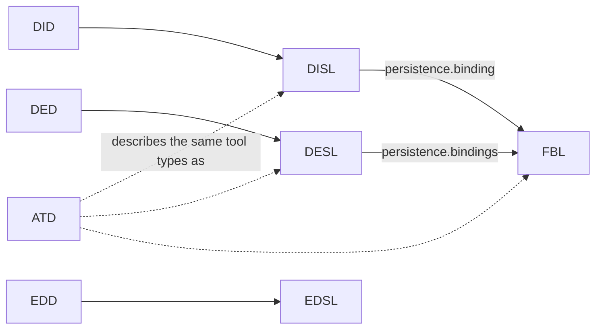

# ADP specifications — architecture

The structure and naming rules of the repository are normative in the [constitution](.specify/memory/constitution.md) (`constitution`, "Structure and Naming"). This document does not restate them. It maps the boundaries they produce and the edges between them.

## Topology

- **Language specifications** (`specifications/<name>/`): one folder per language. Each holds its normative document `<NAME>-specification.md`, its schema `<name>.schema.json` and its examples `*.<name>` side by side. The module nodes are `disl`, `did`, `desl`, `ded`, `edsl`, `edd`, `fbl` and `atd`.
- **Tool definitions** (`definitions/`, `definitions`): the concrete tool types ADP ships, written in those languages.
- **Validators** (`.github/`, `ci-validators`): the Build workflow and its scripts, which enforce constitution principle II on every pull request.
- **Feature specs** (`specs/`, `specs-archive`): the Spec Kit features of every repository but standalone.
- **Shared vocabulary** (`docs/terminology.md`, `terminology`): the definitions every file, name and message uses.

## Edges between languages

- A definition language reads against its paired specification language: a `.did` file is a diagram of a type specified in a `.dis` file, and the same holds for designers and editors.
- DISL and DESL point at FBL bindings when a tool's model lives in another tool's file. FBL never depends on a particular kind.
- ATD describes, in one text language, the same tool types that DISL, DESL and FBL describe. While phase 1 of spec 035 lasts, tool descriptions are written beside the JSON files and checked against them, and no host loads from them. That is why the ATD edges are dashed: ATD *references* these languages but does not *depend on* them. *(How this edge changes after phase 1 is unconfirmed.)*
- `definitions/` depends on every language it is written in. The validators depend on every schema and on the ATD grammar.

## Invariants

- Document, schema and examples change together in one pull request (constitution II).
- Normative text uses RFC 2119 and RFC 8174 key words in bold capitals. Computed values use CEL. Schemas are JSON Schema draft 2020-12 (constitution III).
- Every specification document, placeholders included, ends its header table with the Apache-2.0 `Licence` row. `licence-check.py` enforces this.
- Every specification states its version and status at the top, and breaking changes from 1.0 onwards need a new major version (constitution IV).
