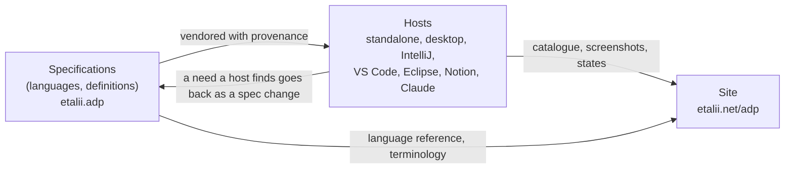
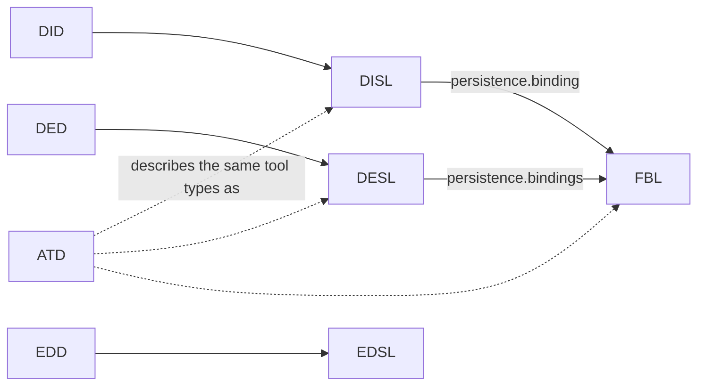

# ADP — architecture

ADP is one set of specifications, kept in this repository, and several hosts, each in a repository of its own, that interpret them. The structure and naming rules of this repository are normative in the [constitution](.specify/memory/constitution.md) (`constitution`, "Structure and Naming"). This document does not restate them. It maps the boundaries they produce and the edges between them.

## Topology

In this repository:

- **Language specifications** (`specifications/<name>/`): one folder per language. Each holds its normative document `<NAME>-specification.md`, its schema `<name>.schema.json` and its examples `*.<name>` side by side. The module nodes are `disl`, `did`, `desl`, `ded`, `edsl`, `edd`, `fbl` and `atd`.
- **Tool definitions** (`definitions/`, `definitions`): the concrete tool types ADP ships, written in those languages.
- **Validators** (`.github/`, `ci-validators`): the Build workflow and its scripts, which enforce constitution principle II on every pull request.
- **Feature specs** (`specs/`, `specs-archive`): the Spec Kit features of every repository but standalone.
- **Shared vocabulary** (`docs/terminology.md`, `terminology`): the definitions every file, name and message uses.

In other repositories, specified here (each node in `hosts/` or `site/` describes code that lives elsewhere):

- **Hosts** (`hosts`): one node per host, with what every host owes the specifications and the edges between hosts.
- **Site** (`site`): `etalii.adp.site`, the product's public face and the published language reference.

## Tool-type approaches

ADP is moving every tool type to one language, ATD (`atd`), and `.atd` alone is the final form (spec 035, ruling of 2026-10-22). Until that transition is complete, three approaches are supported side by side. None of them is a defect to be removed before its successor runs:

1. **Host-coded tool types.** A host implements a tool type in its own code. This is how every editor works today, because EDSL and EDD are placeholders: standalone's JSON, XML, YAML, Markdown and plain-text editors, and the desktop host's ports of them. It is also how IntelliJ's FreeMind and draw.io diagrams and several standalone diagram modules (Wardley map, supply chain) work.
2. **Interpreted specifications with residue code.** A host interprets the vendored DISL or DESL specification and its FBL binding (with CEL) generically, and adds code only for what the languages cannot yet express. This residue is recorded per tool type, and the gaps are reported upstream. Standalone's DISL-backed modules, the desktop host, the VS Code host and the Notion add-ons work this way.
3. **ATD tool descriptions.** A tool type is described completely in `.atd`. In phase 1, descriptions are written, checked, validated and debugged (the desktop host's `atd` and `atd-lsp`, used by VS Code and IntelliJ too), and no host runs a tool from them. Converting existing tool types and running them from `.atd` are later phases, each specified as a feature of its own.

## Edges between languages

- A definition language reads against its paired specification language: a `.did` file is a diagram of a type specified in a `.dis` file, and the same holds for designers and editors.
- DISL and DESL point at FBL bindings when a tool's model lives in another tool's file. FBL never depends on a particular kind.
- ATD describes, in one text language, the same tool types that DISL, DESL and FBL describe. While phase 1 of spec 035 lasts, tool descriptions are written beside the JSON files and checked against them, and no host loads from them. That is why the ATD edges are dashed: ATD *references* these languages but does not *depend on* them. *(How this edge changes after phase 1 is unconfirmed.)*
- `definitions/` depends on every language it is written in. The validators depend on every schema and on the ATD grammar.

## Invariants

- Document, schema and examples change together in one pull request (constitution II).
- Normative text uses RFC 2119 and RFC 8174 key words in bold capitals. Computed values use CEL. Schemas are JSON Schema draft 2020-12 (constitution III).
- Every specification document, placeholders included, ends its header table with the Apache-2.0 `Licence` row. `licence-check.py` enforces this.
- Every specification states its version and status at the top, and breaking changes from 1.0 onwards need a new major version (constitution IV).
