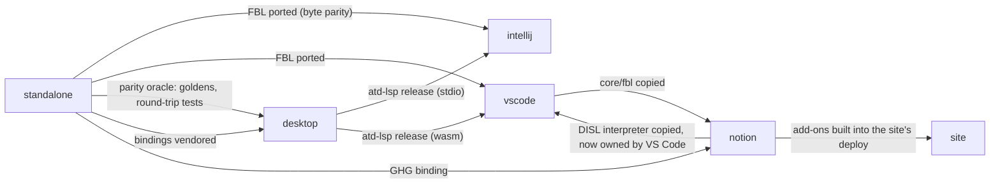

# Hosts

A **host** is a repository that makes ADP's tools available on one platform. Several hosts exist side by side, and none of them is the reference implementation (goal `adp`). Each one meets the same vision under its own platform's constraints. This node states what every host owes ADP, what each host needs from its platform, and the edges between hosts. Each host's own node holds the rest.

## The hosts

States as of 2026-10-24, from each repository and the site's refreshed `sources/hosts/hosts.json`:

| Host | Repository | Platform | State | Node |
|---|---|---|---|---|
| Standalone | `etalii.adp.ide.standalone` | Web workspace: ASP.NET Core + React over gRPC-Web, run locally | Available (alpha releases); widest tool coverage | `host-standalone` |
| Desktop | `etalii.adp.ide.desktop` | Native Rust application (egui/wgpu) | v1.0.0 (2026-10-23); parity with standalone; home of the ATD toolchain | `host-desktop` |
| IntelliJ Platform | `etalii.adp.ide.intellij` | IntelliJ Platform plug-in (Java, Swing) for every JetBrains IDE | In progress: 2 tool types | `host-intellij` |
| Visual Studio Code | `etalii.adp.ide.vscode` | VS Code extension (TypeScript, custom text editors, webviews) | In progress: 5 tool types | `host-vscode` |
| Eclipse | `etalii.adp.ide.eclipse` | Eclipse plug-in | Repository only, no code | `host-eclipse` |
| Notion | `etalii.adp.ide.notion` | Static add-on pages embedded in Notion, plus a Cloudflare Worker | In progress: 1 add-on | `host-notion` |
| Claude | `etalii.adp.ide.claude` | Tools opened within a Claude conversation | Repository only, no code | `host-claude` |

The site (`site`) is not a host. It presents the hosts and the tools.

## What every host owes ADP

- **Interpret, don't redefine.** A host implements the specifications of `etalii.adp`. A need it discovers, or an output a specification leaves undecided, goes back as a specification change or an issue there before hosts diverge (constitution I). A host never settles such a question in its own code.
- **Vendor the specifications with provenance.** Specifications, bindings, examples and fixtures are copied byte for byte with the revision they came from, are refreshed only by a sync script, and are never edited in the host. A `--check` in the host's CI keeps the copy honest.
- **Files are the source of truth.** The model lives in the user's file, written through FBL splices, so bytes outside an edit stay as they were. Authored layout goes in the `.adp` registration, never in another tool's body. Where the platform has no files (Notion), the platform's own store is the model, and the host states what that costs.
- **Native citizenship.** Undo, save, dirty state, themes, dialogs and accessibility are the platform's own, not re-implemented beside it.
- **No network at run time and no downloaded code.** The exception is a host whose platform is itself a service (Notion's OAuth Worker). A tool is never fetched and executed (DISL §13.1, §16).
- **One frame, many tool types.** Generic code names no tool type; per-tool-type code lives in a module, plugin or residue that is declared as such. Hosts enforce this with lint rules and word tests.
- **Shared vocabulary and delivery.** Every host's CI runs `etalii.adp`'s terminology check. Delivery follows the organisation's rules (`docs/new-repository.md`): `develop`, pull requests only, merge commits.
- **Planning.** Every host is changed through a Spec Kit feature in this repository (`specs-archive`), checked against its principles (`principles-*`). Standalone planned in its own spec-workflow until 2026-10-31.

## What each host needs from its platform

- **Standalone:** grpc-web has neither bidirectional nor client streaming, and HTTP/1.1 allows six connections per origin. Hence two one-way call legs and one stream per tab. It is also built for an F5-local workflow in Rider.
- **Desktop:** no .NET, JavaScript, browser or web view at run time. It needs AccessKit accessibility on every interactive element, per-user app-data state, and performance targets above the standalone host's.
- **IntelliJ:** common platform modules only, so it runs in all 8 JetBrains IDEs. Edits go through the platform `Document` and undo, and it ships no third-party libraries.
- **VS Code:** custom *text* editors keep the platform's undo and dirty state. Webviews run under a strict CSP. A manifest selector can match only file names, so tool types that share an extension reopen by marker.
- **Notion:** the model lives in Notion database rows and not in a file. Notion has no CORS and needs a client secret, rate limits writes, offers no conditional write and has no shared undo. Hence a minimal service and the host's own history.
- **Claude:** tools open inside a conversation rather than an IDE. Its needs are not yet specified.
- **Eclipse:** an Eclipse plug-in. Its needs are not yet specified.

## Edges between hosts

Hosts share code only by copying it with provenance or by consuming a pinned release, never through a runtime dependency:

- **The standalone host is the worked example, not the reference.** The desktop host replays standalone's recorded behaviour as its parity oracle, and IntelliJ and VS Code ported standalone's FBL library with byte parity. Where a host disagrees with standalone, the specification decides.
- **The desktop host owns the ATD toolchain.** Its `atd` CLI checks every tool description in `etalii.adp`'s CI (`ci-validators`). Its `atd-lsp` releases (`atd-v*`, SHA-256-pinned) give IntelliJ and VS Code their ATD language support.
- **Bindings named by URLs into standalone** (a raw `develop` address in a `.dis`) are a known weakness (etalii.adp issue 92): a host vendors them at a pinned commit.
