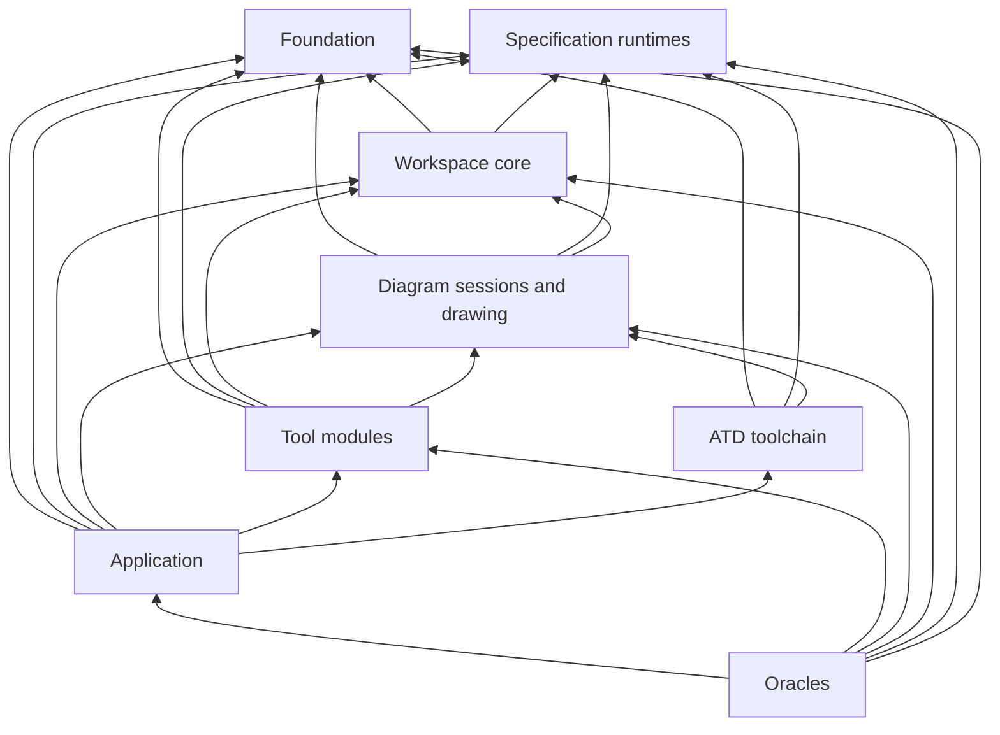

# Desktop

Repository: [`etalii.adp.ide.desktop`](https://github.com/etalii-adp/etalii.adp.ide.desktop)

ADP's tools as one native Rust application, for a person working on their own files. There is no sign-in, server, browser or web view. Its principles are `principles-desktop`: native citizenship, the text file as source of truth, one frame for many tools, test-first against real files and the standalone host, simplicity, and no clippy warnings. It is specified by spec 030 (the host) and spec 035 (the ATD toolchain).

## State

v1.0.0 released 2026-10-23. All 70 rows of the parity inventory against the standalone host (reference commit `8b6ccfc`) are checked. It runs 19 diagram modules, the Knowledge designer, the editors (plain, Markdown, JSON, XML, YAML and `.atd`) and the full shell.

Beyond parity, it is the home of the ATD toolchain: `.atd` editing in the shell, the `atd` CLI and `atd-lsp`. Releases are unsigned zip and tar.gz packages: signing was dropped on 2026-10-24, and no installers are built. The search panel is a placeholder.

## Shape

A headless **core** of library crates and one **shell** crate, talking through in-process calls and one event channel per window. This replaces the standalone host's unary calls and its stream per tab, and keeps every behaviour testable headless on Windows, macOS and Linux.

- **UI:** `eframe`/egui on `wgpu`, with AccessKit, native file dialogs (`rfd`) and VS Code 1.142's Dark and Light 2026 themes value for value. Behaviour follows the standalone host.
  - **Why:** the most complete accessibility support, one style holding every theme value, and an immediate mode with culling that keeps 1,000-element canvases and 10,000-row tables at pointer speed.
  - **Rejected:** iced, Slint, gpui, Xilem, gtk4 and Tauri. Tauri is excluded because the host may run no web view.
- **Language:** Rust stable, edition 2024. `unsafe_code` is denied workspace-wide. The one exception is `adp-libxml2`, the one C dependency (libxml2 for XSD/DTD validation, which has no pure-Rust equivalent), with all file access through a resolver scoped to the project.

## Layers

The host is divided into eight modules, each with its crates as submodules. Arrows point at what a layer depends on, and no layer reaches a layer above it.

| Module | Node | What it holds |
|---|---|---|
| Foundation | `desktop-foundation` | history, context, documents, text, layout, theme, libxml2 |
| Specification runtimes | `desktop-specification-runtimes` | CEL, FBL, DISL and DID, DESL and DED, the scene |
| Workspace core | `desktop-workspace` | the window handle and event channel, catalogue, projects, problems, hierarchy |
| Diagram sessions and drawing | `desktop-diagram-sessions` | open diagrams and the recording painter |
| Tool modules | `desktop-tool-modules` | the diagram modules' residue, the Knowledge designer, the editors |
| ATD toolchain | `desktop-atd-toolchain` | spec 035's crates, the `atd` CLI and `atd-lsp` |
| Application | `desktop-application` | the shell and the add dialog |
| Oracles | `desktop-oracles` | conformance and parity, test-only |

- **Headless below the application.** Every layer below `desktop-application` is a library that never uses egui, so every behaviour is testable headless. Only the shell uses egui, `rfd` or `syntect`, and only it links every module. A module depends on core crates and the theme, never on the shell.
- **The ATD toolchain stays clear of the workspace and the shell,** so `atd` and `atd-lsp` ship without the window.
- **Shape:** the crates sit flat under `crates/`, with the modules under `modules/`. The layers above are this graph's grouping of those crates, by their dependencies. *(The repository itself names no such layers.)*

## How it consumes the specifications

- `vendor/etalii.adp/` holds the specifications and definitions, locked at one etalii.adp commit and refreshed only by `tools/sync-etalii-adp.py`. CI checks the lock, and hand edits are forbidden.
- Bindings that specifications name by a URL into the standalone repository are vendored separately at a pinned commit.
- The vendor folder ships beside the executable and is read at run time.
- DISL, DID, DESL, DED, FBL and CEL are interpreted generically (approach 2 of `architecture` *Tool-type approaches*). A specification that fails to load still lists its tool type, with findings, and opens nothing. A later major version is refused, and a later minor version gives a warning.
- Some modules still bypass DISL as the standalone host does: C4's specifications do not yet load, and Azure DevOps uses its own parser and writer.
- EDSL has no runtime. Editors are hand-ported (approach 1).
- **ATD:** spec 035 phase 1. `.dis`, `.des` and `.fbl` stay the files the host runs. The `atd` CLI checks every tool description in `etalii.adp`'s CI (`ci-validators`), and `atd-v*` releases publish `atd` and `atd-lsp` with SHA-256 files for the other hosts (`hosts`).

## Rules and decisions

- **Identical bytes to the standalone host for the same edit.** Every body write is FBL splices, and authored positions go only in the `.adp`.
- **Behaviour comes from the vendored definitions.** A divergence is recorded in the parity inventory or raised upstream, never settled in the host. Where the standalone host's behaviour differs from the planned design, the standalone host wins; for example, the four named layout modes the standalone host never built are not invented here.
- **Goldens and parity scripts are never edited to make a replay pass.** A mismatch becomes an ignored test with its reason.
- **Nothing is written to a workspace that the standalone host would not write.** Per-user state lives in the app-data folder, and saves are atomic.
- **No .NET, JavaScript, browser, listener or downloaded code at run time.** The language server runs in-process over an in-memory connection. The .NET parity recorder is the one non-Rust artefact, used offline only.
- **Performance targets** are measured by criterion benches:
  - project list within 2 s;
  - a 5,000-file workspace within 3 s;
  - a change on disk shown within 1 s;
  - at most half the memory of the standalone host plus its browser tab.

## Process

Changed through Spec Kit features in this repository (030, 032, 035). CI runs the vendor check, then fmt, clippy `-D warnings` and tests on all three operating systems, the ATD checks, `cargo deny`, packaging, a development pre-release from `develop`, and the terminology check.
