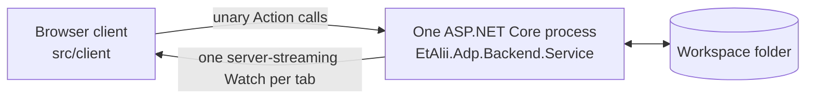
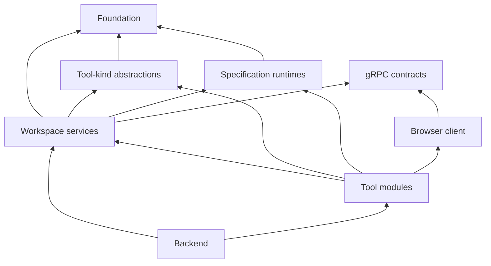

# Standalone

Repository: [`etalii.adp.ide.standalone`](https://github.com/etalii-adp/etalii.adp.ide.standalone)

The standalone web workspace. It opens tools (diagrams, designers and editors) from a user's own workspace folder, draws them and lets the user edit them, while the documents stay plain, diffable files in that folder. It is the host with the widest tool coverage and the worked example the other hosts port from, but it is **not the reference**: its technical shape is how this host works, not a standard (goal `adp`). Sources: the repository's `CLAUDE.md`, `docs/steering/` (spec-workflow's `.spec-workflow/steering/` until 2026-10-31) and `docs/architecture.md`. Where this node and those disagree, they win and this node is stale.

## State

Available as alpha releases, a platform-neutral ZIP from each green `develop` build. `docs/tools.md` is the catalogue of record; as of 2026-10-24 it lists 11 tool types implemented, 22 prototypes and 3 in progress, out of 102 identified. It runs locally as a console application with a browser client. Windows-service and Docker hosting, a chromeless window, remote hosting and partial embedding in VS Code are intended and not built; nothing assumes they never arrive.

## Shape

- **One process.** ASP.NET Core serves the built client and hosts the gRPC-Web endpoint. In development it proxies to Vite for hot reload. In production no Vite runs.
- **The filesystem is a boundary, and only the backend crosses it.** Access is scoped to workspace folders the user opened.
- **`.proto` is the stable boundary** between backend and client (`standalone-api`). Either side may change freely while the contract holds.
- **Core never depends on a tool type.** Modules are discovered by reflection, and deleting a module's folder removes the type.

## Layers

The host is divided into nine modules, each with its subsystems as submodules. Arrows point at what a layer depends on, and no layer reaches a layer above it.

| Module | Node | What it holds |
|---|---|---|
| Foundation | `standalone-foundation` | primitives, files, documents, history, layout |
| Specification runtimes | `standalone-specification-runtimes` | CEL, loader plumbing, FBL, DISL |
| Tool-kind abstractions | `standalone-tool-kinds` | the diagram, editor and designer contracts |
| Workspace services | `standalone-workspace-services` | sessions, authentication, context, projects, hierarchy, problems, the gRPC services |
| Tool modules | `standalone-tool-modules` | the diagram module bases, and one module per tool type of each kind |
| Backend | `standalone-service` | composition, static hosting, the Vite proxy in development |
| gRPC contracts | `standalone-api` | the `.proto` boundary between backend and client |
| Browser client | `standalone-client` | canvas, table and hierarchy-surface libraries, editor plumbing, the shell |
| Guards and gates | `standalone-guards` | the tests and gates that keep these rules true, across every layer |

- **Direction:** the host process depends on the core, never the reverse. Only the host process and the host-only projects of the workspace services (Authentication, Problems, Workspace) carry ASP.NET Core or the gRPC server. A tool module never reaches them.
- **Shape:** `src/backend/EtAlii.Adp.slnx` is a flat list of 152 projects (51 core, 86 diagram, 10 editor, 4 designer, 1 spanning), so the whole solution opens and builds in Rider. The layers above are this graph's grouping of those projects, by their references. *(The repository itself names no such layers.)*

## How it consumes the specifications

- DISL definitions and FBL bindings are **bundled byte for byte** into each module's `definition/` folder with `provenance.json` (revision and SHA-256), and never edited in the host.
- `standalone-disl`, `standalone-fbl` and `standalone-cel` interpret them generically: palette, menus, property rows, findings, drops, operations and splices.
- **There is no generic "DISL-only" path yet.** Every tool type is still a module, and a module's residue (what the languages cannot express) is listed in a companion beside its definition. This is approach 2 of `architecture` *Tool-type approaches*.
- Designers name their surface in DESL. Hierarchical-requirement documents are recognised by their DED envelope.
- Editors are host code (approach 1). `src/editors/{json,xml}/readme.md` list what an EDSL specification would have to state (etalii.adp issue 154).
- The host has no ATD code. In the spec 035 plan, adopting ATD in standalone is a later phase.

## Decisions

From `tech.md`'s decision log, each with its why:

1. **Files, not a database:** diagrams stay reviewable and mergeable. Revisit only for hosted or multi-user use.
2. **gRPC between client and backend:** typed contracts and native streaming suit pushing changes to open clients.
3. **.NET backend:** the team's Rider, F5-first workflow.
4. **React + TypeScript client, not Blazor:** a more mature diagramming ecosystem. The canvas is SVG; tech.md's "WebGL-rendered" wording is stale.
5. **ASP.NET Core hosts the React build:** one process in production and no JS-interop boundary on the delta path.
6. **One context service** (`standalone-context`): selection is cross-cutting, so it is resolved once and pushed.
7. **Commands for every state change** (`standalone-history`): undo is a property of the system and not of each feature.
8. **Unary `Action` + streaming `Watch`:** grpc-web limits. This also makes each call authorizable and retryable, and gives per-connection state an owner and a lifetime.
9. **Bottom-up implementation order:** data model, then persistence, wire, UI, and the remaining logic. Each layer is tested before the next.
10. **No orphaned types:** measured, not assumed. Re-measure before hunting dead code.
11. **Concurrent saves take turns:** `standalone-documents`.

## Process

- **Planning:** standalone is changed through Spec Kit features in this repository, `specs/NNN-standalone-*`, checked against its principles (`principles-standalone`). It planned in **spec-workflow** (`.spec-workflow/`, with an approval dashboard) until 2026-10-31: its nine finished archived specs were migrated into `specs/016-*` to `specs/024-*` on 2026-10-10, and its six unfinished ones into `specs/068-*` to `specs/073-*` when it was retired; its steering documents moved to `docs/steering/` in that repository.
- **Team:** one Scrum master, four Developers (one per specification, exclusively), two Architects and two Testers (`docs/steering/roles.md`).
- **Gates and CI:** four local gates (`npm test`, typecheck, `dotnet format style`, `dotnet test`) and CI with InspectCode (constitution VI). See `standalone-guards`.
