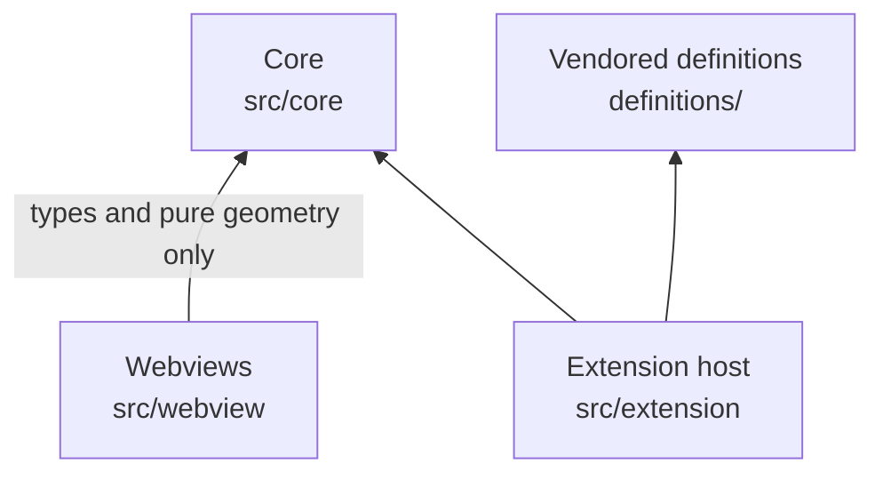

# VSCode

Repository: [`etalii.adp.ide.vscode`](https://github.com/etalii-adp/etalii.adp.ide.vscode)

One VS Code extension (`adp`, shipped as a `.vsix`) for people who work in VS Code and want ADP's diagrams and designers on files kept in version control, files that agents often read too. Its principles are `principles-vscode`. It is specified by specs 006, 009, 027 and 035.

## State

In progress. Five prototype tool types are interpreted from their definitions:

| Tool type | Kind | Files |
|---|---|---|
| Gartner hype cycle graph | diagram | `.ghg` |
| Agent Behavior Modelling | diagram | `.md`, layout in an `.adp` beside it |
| Mind map | diagram | Freeplane `.mm` |
| Agent activity diagram | diagram | `.aad` |
| Knowledge | designer | `.yaml`, `.json`, `.xml`, `.ded` |

`.atd` files get language support and an editor. Not built:

- the editor kind;
- clipboard;
- the three diagrams that need their own persistence plugin instead of FBL (timeline, dependency graph, .NET dependency graph).

## Shape

- **Custom text editors.** One custom *text* editor per tool type, plus one for `*.adp` that opens its diagram. Why: the platform's undo, redo, dirty state, save, revert, hot exit and "Open With" all keep working unchanged.
- **Bundles and webviews.** Four esbuild bundles: the extension host, an ATD worker, and browser webviews for the canvas, the table, ADP Properties and the ADP Toolbox. The last two live in an "ADP" activity-bar container.
- **Shared extensions.** Tool types that share a file extension (Markdown, YAML, JSON, XML) are registered as an `option` and reopened in the tool when their marker matches, because a manifest selector can match only file names.

## Layers

Three code layers, one per folder under `src/`, enforced by lint and a words test, plus the vendored definitions they read. Arrows point at what a layer depends on.

| Module | Node | What it holds |
|---|---|---|
| Core | `vscode-core` | the frame, FBL, DISL, DESL, the scene, definitions to tool types, plugins |
| Extension host | `vscode-extension` | activation, custom editors, edits as one `WorkspaceEdit`, views, commands; the ATD client |
| Webviews | `vscode-webviews` | the canvas, the table, ADP Properties and the ADP Toolbox |
| Vendored definitions | `vscode-definitions` | the copied definitions and the sync script |

- **The core knows no `vscode` and no DOM.** The extension host may use `vscode` and has no DOM. The webviews import from the core only types and pure geometry, and the extension host and the webviews never import each other; they talk through the webview protocol in `vscode-frame`.
- **Code for one tool type lives only in `vscode-plugins`.**

## How it consumes the specifications

- `definitions/<tool>/` holds byte-for-byte copies of `.dis`/`.des`, `.fbl` and companions from `origin/develop` of etalii.adp and the standalone host, with `PROVENANCE.md`.
- `npm run sync-definitions` refreshes the copies and generates the `package.json` entries for each tool type. Its `--check` runs in CI.
- Approach 2 of `architecture` *Tool-type approaches*: DISL 0.4, DESL 0.1 (table surface) and FBL are interpreted, and CEL is evaluated through cel-js.
  - A newer minor version opens with a warning, and a different major version is not loaded.
  - Unsupported constructs fall back to the nearest supported one, with a finding.
  - The full matrix is in `docs/disl-support.md`, held to the code by a test.
- There is no generic DID handling; the document is the domain file read through FBL.
- **ATD:** a TextMate grammar generated in etalii.adp, plus the desktop host's `atd-lsp` compiled to wasm. It runs on a worker thread with no child process or socket, and is fetched from the `atd-v0.1.0` release with a SHA-256 pin.

## Rules and decisions

- **The text document is the only model.** Every change is FBL splices applied as one `WorkspaceEdit`, so the platform's undo works and unrelated bytes are kept. FBL's own history is not used.
- **Registration-only changes** (row drags and Arrange in Agent Behavior Modelling) get their own layout undo stack, with commands bound only while such a step is next, because the body's undo has nothing to take back.
- **One frame, many tool types.** No tool-type names in generic folders. A plugin is the only escape, and any other exception needs a row in the support record.
- **Webviews are thin and the core is headless,** so the core is testable and shareable. The shared text metric (0.55 × font size per UTF-16 unit) gives every host the same boxes.
- **Webview CSP:** `default-src 'none'`, scripts by nonce only. Styles allow `'unsafe-inline'`, a small deviation from the principles.
- **No network at run time.** Vendored inputs are pinned and verified: definitions, examples, FBL fixtures and the ATD release.
- **The definition is the reference, and standalone is the worked example.** Disagreements are raised as etalii.adp issues and never settled here.

## Process

Changed through Spec Kit features in this repository. Tests run at three levels: vitest for the core and webviews, and `@vscode/test-electron` against the packaged extension. CI runs file checks, the plug-in job (sync check, lint, unit and VS Code tests, `.vsix` artifact), a development pre-release from `develop`, and the terminology check.
