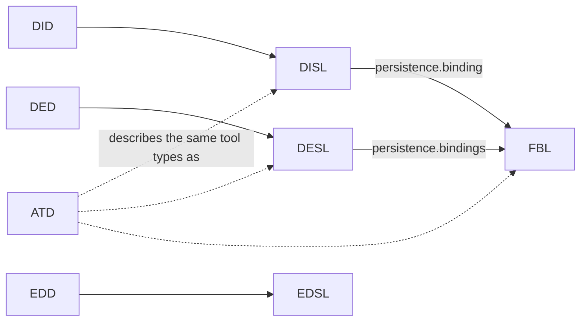

# Languages & Grammars

`specifications/` holds one folder per language. Each folder holds the language's normative document `<NAME>-specification.md`, its schema `<name>.schema.json` and its examples `*.<name>` side by side (constitution, "Structure and Naming"). This node groups the languages and holds the edges between them. Each language's own node holds its responsibility and boundary.

| Kind | Specification language | Definition language |
|---|---|---|
| Diagram | Diagram Specification Language (DISL), `disl` | Diagram Definition Language (DID), `did` |
| Designer | Designer Specification Language (DESL), `desl` | Designer Definition Language (DED), `ded` |
| Editor | Editor Specification Language (EDSL), `edsl` (placeholder) | Editor Definition Language (EDD), `edd` (placeholder) |

Two languages serve every kind:

- **Format Binding Language (FBL), `fbl`:** how a tool reads and writes a model that lives in another tool's file.
- **ADP Tool Language (ATD), `atd`:** one text language in which a tool type of any kind is described completely. It is the final form of every tool type's specification (`architecture`, *Tool-type approaches*).

## Edges between languages

- **Definition languages:** a definition language reads against its paired specification language. A `.did` file is a diagram of a type specified in a `.dis` file, and the same holds for designers and editors.
- **FBL:** DISL and DESL point at FBL bindings when a tool's model lives in another tool's file. FBL never depends on a particular kind.
- **ATD:** it describes, in one text language, the same tool types that DISL, DESL and FBL describe. While phase 1 of spec 035 lasts, tool descriptions are written beside the JSON files and checked against them, and no host loads from them. That is why the ATD edges are dashed: ATD *references* these languages but does not *depend on* them. *(How this edge changes after phase 1 is unconfirmed.)*
- **Outside this group:** `definitions` depends on every language it is written in, and `ci-validators` depends on every schema and on the ATD grammar.

## Invariants

- Document, schema and examples change together in one pull request (constitution II).
- Normative text uses RFC 2119 and RFC 8174 key words in bold capitals. Computed values use CEL. Schemas are JSON Schema draft 2020-12, except that a text language's schema describes its parsed tree (constitution III and "Structure and Naming").
- Every specification document, placeholders included, ends its header table with the Apache-2.0 `Licence` row. `licence-check.py` enforces this.
- Every specification states its version and status at the top, and breaking changes from 1.0 onwards need a new major version (constitution IV).
